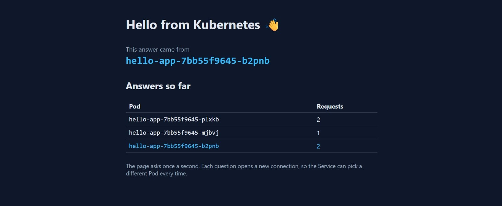

# Lab 2 — hello-app on Kubernetes

Your copy of this repository is your submission. The lab sheet is on the course site; this file is where you record what you did.

What's here:

| File | What it is |
|---|---|
| `src/`, `index.html` | a small React page that shows which Pod answered |
| `nginx.conf` | serves the page, and answers `/whoami` with the Pod name |
| `Dockerfile` | builds the page, then serves it with nginx on port 80 |

You don't change any of these. You add `hello-app.yaml` and fill in the sections below.

## Before you push, check

- [ ] `hello-app.yaml` is in the root of this repository
- [ ] `screenshot.png` is in the root of this repository
- [ ] every section below is filled in

---

## 1. My image

Docker Hub image I deployed (for example `ravi123/hello-app:v1`):

```
hvarsha/hello-app:v1
```

## 2. Pods across nodes

Output of `kubectl get pods -o wide` after you applied `hello-app.yaml`:

```
NAME                         READY   STATUS    RESTARTS   AGE   IP            NODE              NOMINATED NODE   READINESS GATES
hello-app-65b498dc44-6gq5b   1/1     Running   0          20s   10.244.2.11   desktop-worker2   <none>           <none>
hello-app-65b498dc44-dktln   1/1     Running   0          20s   10.244.2.12   desktop-worker2   <none>           <none>
hello-app-65b498dc44-fdf2s   1/1     Running   0          20s   10.244.1.8    desktop-worker    <none>           <none>
```

## 3. The Service and its endpoints

Output of `kubectl get service hello-app` and `kubectl get endpointslices -l kubernetes.io/service-name=hello-app`:

```
NAME        TYPE           CLUSTER-IP     EXTERNAL-IP   PORT(S)          AGE
hello-app   LoadBalancer   10.96.74.166   172.18.0.7    8080:31071/TCP   23s

NAME              ADDRESSTYPE   PORTS   ENDPOINTS                            AGE
hello-app-gkcg6   IPv4          80      10.244.1.8,10.244.2.12,10.244.2.11   41s
```

## 4. Browser

Add `screenshot.png`: the page at `http://localhost:8080` with at least two Pods in the "Answers so far" table.


## 5. The four traps

For each trap, write what you saw and why it happened, in two or three lines of your own words.

**Trap 1 (local image):** Pods showed ErrImagePull/ImagePullBackOff because `hello-app:v1` exists only in my laptop's Docker. The nodes pull images from a registry, and that name doesn't exist on Docker Hub. Pushing it as `hvarsha/hello-app:v1` fixed it.

**Trap 2 (selector typo):** I changed the Service selector to `helo-app`. The EndpointSlice showed PORTS `<unset>` and ENDPOINTS `<unset>`, and the browser showed ERR_EMPTY_RESPONSE. No Pod had that label, so the Service had nowhere to send traffic. Fixing the selector restored it.

**Trap 3 (wrong targetPort):** I changed targetPort to 8080. The EndpointSlice listed the Pod IPs but with port 8080, and the page showed an error. The Service found the Pods but sent traffic to port 8080, and nginx listens on 80. Changing it back to 80 fixed it.

**Trap 4 (EXTERNAL-IP):** EXTERNAL-IP 172.18.0.7 is inside Docker Desktop's private network, so my laptop can't reach it. I used http://localhost:8080 instead.

**How to tell Trap 2 and Trap 3 apart:** The EndpointSlice. Empty means the selector is wrong. Pods listed on the wrong port means the targetPort is wrong.